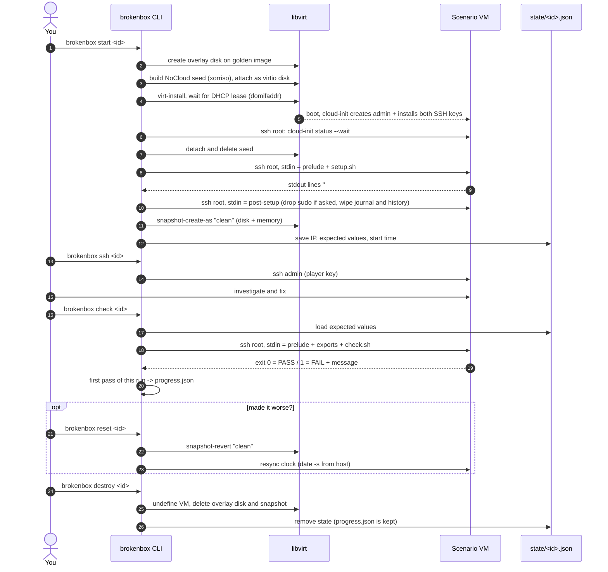

# brokenbox

[](LICENSE)
[](https://www.python.org/downloads/)
[](#requirements)

Practice Linux troubleshooting on your own machine, in disposable KVM virtual machines.

Each scenario boots a fresh Debian 12 VM, a setup script breaks something, you SSH in
and fix it, and `brokenbox check` tells you whether you solved it. Every scenario is based on a problem people keep hitting on real servers. The questions
that inspired it (on Stack Exchange) are listed in its `scenario.toml` under `inspired_by`.

## Requirements

- Linux with KVM (`/dev/kvm`), libvirt (`qemu:///system`) with the `default` pool + network
- `virsh`, `virt-install`, `xorriso`, `ssh`, `curl`, Python >= 3.11 (stdlib only)
- your user in the `libvirt` and `kvm` groups

```bash
sudo apt install qemu-kvm libvirt-daemon-system virtinst xorriso
sudo usermod -aG libvirt,kvm $USER   # then log out/in
```

## Quick start

```bash
./brokenbox-cli doctor          # check prerequisites
./brokenbox-cli build-base      # one-time: download Debian 12 + bake the golden image (~5 min)
./brokenbox-cli list
./brokenbox-cli start ghost-space
./brokenbox-cli ssh ghost-space  # you are 'admin', with sudo
./brokenbox-cli check ghost-space
./brokenbox-cli reset ghost-space # back to freshly-broken state (instant, via snapshot)
./brokenbox-cli destroy ghost-space
```

### Run it as `brokenbox` from anywhere

Symlink the launcher into a directory on your `PATH` (`~/.local/bin` is on it by default on
most distros):

```bash
ln -s "$PWD/brokenbox-cli" ~/.local/bin/brokenbox
brokenbox list
```

The link points at your checkout, so changes to the code or scenarios apply immediately.
If you move the repo, re-create the link.

Alternatively, `pip install -e .` installs a `brokenbox` command. On Debian/Ubuntu the system
Python refuses this ("externally-managed-environment"), so use `pipx install -e .` or a virtualenv.

## Commands

| command | what it does |
|---|---|
| `doctor` | check host prerequisites |
| `build-base [--rebuild]` | download Debian 12 cloud image, build golden image with tools preinstalled |
| `list` / `status` | list scenarios (with your best time) / running VMs |
| `progress [--clear]` | solved count per difficulty, best times, attempts, recent solves |
| `describe <id>` | print the problem statement |
| `start <id> [--force] [-v]` | create VM, run setup, snapshot. `-v` shows setup output (spoilers) |
| `ssh <id> [--user root] [cmd...]` | SSH in as `admin` |
| `check <id>` | run the checker (the "Check My Solution" button) |
| `reset <id>` | revert to the `clean` snapshot |
| `stop <id>` / `console <id>` | shut down (keep) / attach serial console |
| `destroy <id>` / `destroy --all` | delete the VM and its disk |

## How it works



- Disks live in libvirt's storage pool (`/var/lib/libvirt/images`), so no sudo is
  needed and libvirt never has to read your home directory.
- cloud-init (NoCloud seed ISO) only creates the `admin` user and installs two SSH keys
  (`~/.local/share/brokenbox/keys/`): **player** for `admin`, **control** for `root`.
- `setup.sh` and `check.sh` are piped to root over SSH stdin. They are never written to
  the guest's disk, so they can't be read from inside the VM.
- Expected answers are recorded on the host (`~/.local/share/brokenbox/state/`) and passed
  to `check.sh` as environment variables, never stored in the VM.
- After setup a libvirt snapshot `clean` (disk + memory) is taken and `reset` reverts to it.

## Writing a scenario

```
scenarios/my-scenario/
  scenario.toml   # title, difficulty, kind, time_minutes, sudo, memory, description, test, inspired_by
  setup.sh        # runs as root; break things here
  check.sh        # runs as root; exit 0 = solved
```

Helpers available in `setup.sh`: `expect KEY value` (saved on the host and exported to
`check.sh` as `$KEY`), `as_admin "cmd"`. In `check.sh`: `pass "msg"`, `fail "msg"`.
Set `sudo = false` in `scenario.toml` to drop admin's sudo rights after setup.

Would love to have contributions so feel free to send in a PR with your scenario!

## License

Copyright (C) 2026 Pavithra Rajan

brokenbox is free software: you can redistribute it and/or modify it under the terms of
the GNU Affero General Public License as published by the Free Software Foundation,
either version 3 of the License, or (at your option) any later version. See
[LICENSE](LICENSE) for the full text.
